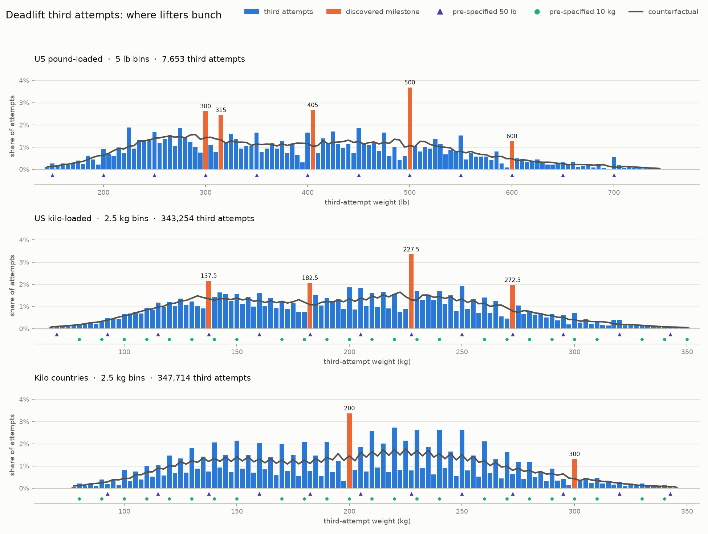
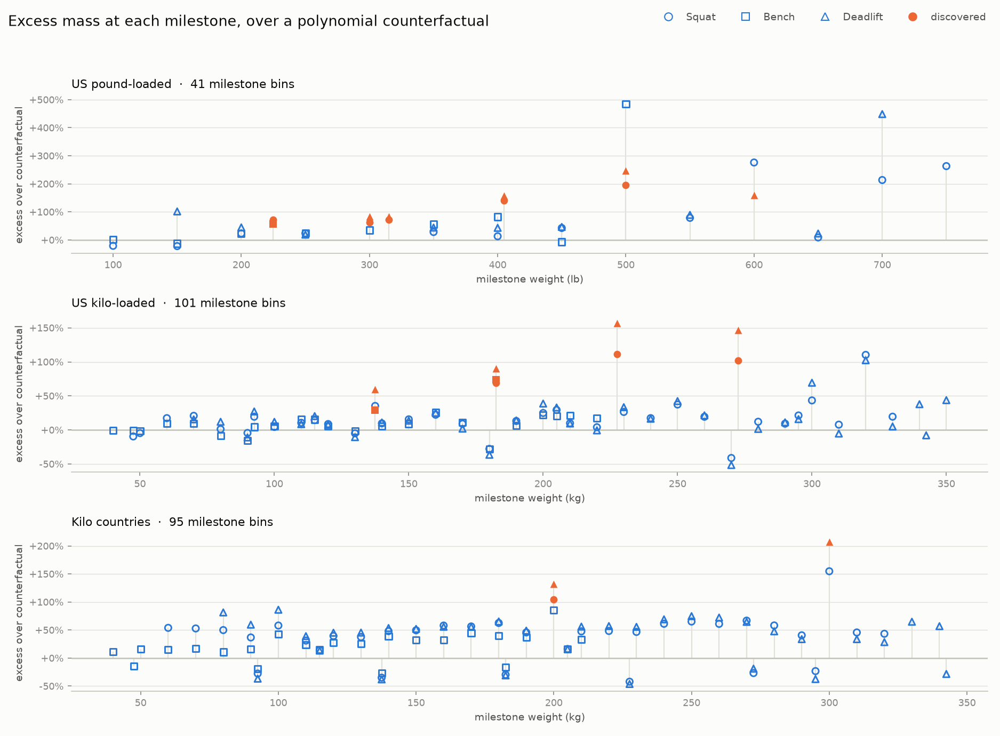
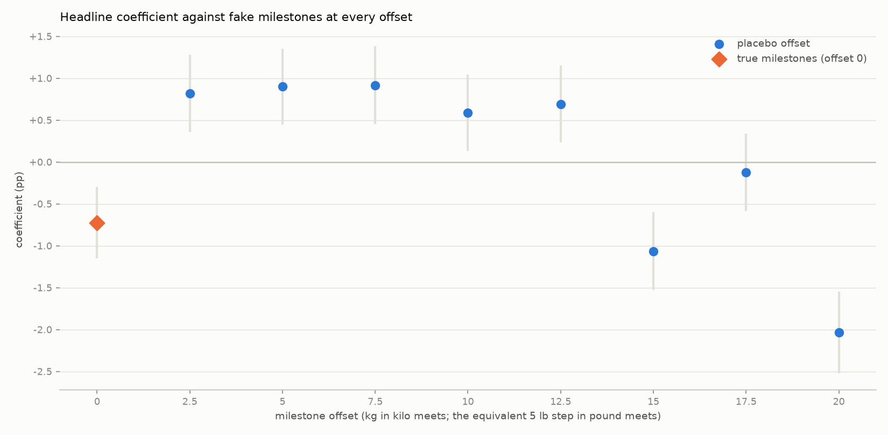

# Powerlifting reference points

Do lifters stretch their third attempts to reach round-number milestones, and
does that lower their success rate?

A reference-dependence study built on the
[OpenPowerlifting bulk CSV](https://openpowerlifting.gitlab.io/opl-csv/bulk-csv-docs.html).
See `CLAUDE.md` for the project rules and `notes.md` for parked decisions.

---

## Research question

A lifter's third attempt is a choice made under uncertainty: go heavier and
risk a miss, or bank a smaller lift. If round numbers carry value of their own
— 500 lb, 200 kg — a lifter sitting just below one has a reason to stretch for
it that has nothing to do with what they can actually lift. The question is
whether that stretching is visible in the data, and whether it costs them the
lift.

## Identification

Attempt weight is chosen, so raw comparisons between milestone and
non-milestone attempts are confounded: lifters pick the weights they think they
can make.

The design rests on **pound milestones and kilo milestones being different
weights**. 500 lb is 226.8 kg, so on a kilo bar the reachable weight is
227.5 kg — a round number to a lifter thinking in pounds and an unremarkable
one to a lifter thinking in kilos. The same physical weight carries two
different meanings depending on who is lifting it.

The key estimate is therefore `on_lb_milestone × lb_region`, from a linear
probability model of third-attempt success, clustered by lifter.

Milestones follow the **meet's loading unit**, decided once per meet, never
attempt by attempt:

| meet loads in | a 500 lb milestone is | because |
|---|---|---|
| kilos | 227.5 kg | the lifter cannot load 226.8 kg on a kilo bar |
| pounds | 226.8 kg | the bar carries the pound figure exactly |

Fake milestones offset from the real grid are the placebo and should show no
effect. `src/diagnostics.py` runs this as a family of offsets rather than a
single one.

## Data and sample

~4.07M rows from the OpenPowerlifting bulk CSV, reduced to **7,286,622 attempts**
(2,428,874 attempt series) by the clean stage:

| restriction | why |
|---|---|
| `Event == SBD`, `Equipment == Raw` | comparable contest and equipment |
| numeric `Place` | DQ / DD / NS / G means the result did not stand |
| attempts 1–3 all present, per lift | never imputed |
| one entry per lifter per meet | see caveats |
| weight on the kilo grid **or** a whole pound | see caveats |

Modelling sample: third attempts that followed a **successful** second
(1,812,850 attempts, 296,596 lifters). A lifter whose second attempt failed is
solving a different problem.

## Data caveats

Four things the OpenPowerlifting documentation does not state, each of which
changed the results when handled:

1. **Multi-division entries are duplicates.** A lifter entered in several
   divisions at one meet appears once per division with the same attempts.
   Left in, the attempt-series window spanned both copies: 168,579 attempt-1
   rows acquired a predecessor and 398,588 fake "repeats" appeared.
2. **Not every meet loads in kilos.** Pound-loaded meets are stored as the kilo
   conversion of a round pound number, which never lands on the kilo grid.
   Treating those as transcription errors discarded *every* literally loaded
   pound milestone — including 1,062 attempts at exactly 226.800 kg, i.e. 500 lb.
3. **The two milestone grids overlap.** The loadable pound grid is mostly spaced
   22.5 kg against the kilo grid's 10 kg, so they coincide roughly every 90 kg.
   At 70, 160 and 250 kg a weight is both a pound milestone and a kilo one, and
   nothing can separate the two treatments there.
4. **`lifter_id` is built from `Name`.** OpenPowerlifting disambiguates shared
   names with a `#N` suffix, which is kept, but same-named lifters it never
   disambiguated are merged and anyone who changed names is split.

## Pipeline

```
ingest -> clean -> features -> discover -> describe -> econ_models -> ml
```

Each stage is a script in `src/`, reads the previous stage's parquet and writes
its own. Stages never reach back into raw data.

```bash
uv sync
make ingest       # download the bulk CSV (~GBs) and convert to parquet
make all          # every stage in order
make diagnostics  # diagnostics on the econ results; not a pipeline stage
make test
```

`make` is not installed on every machine; each target is a one-line
`uv run python src/<stage>.py`.

**Milestone discovery** (`src/discover.py`) splits meets into a discovery and a
test half by a salted hash, finds bunching in the discovery half from attempt
selection alone — never reading `success` — and corrects for scanning hundreds
of weights with Benjamini–Hochberg at q=0.05. Any outcome test on the
milestones it finds uses the test half only.

---

## Headline figures

### 1. Where lifters bunch



Third-attempt deadlift weights, each group drawn on the grid its bar was
actually loaded on. Pre-specified milestones are marked beneath the axis
(pound and kilo on separate rows) and discovered milestones colour the bar.

*Interpretation:*

<!-- Joe writes this -->

### 2. Excess mass at each milestone



Excess over a polynomial counterfactual fitted to neighbouring bins, at every
milestone weight, by group and lift.

*Interpretation:*

<!-- Joe writes this -->

### 3. The placebo family



The headline coefficient re-estimated against fake milestone grids at every
offset from 2.5 to 20 kg (equivalent pound offsets in pound-loaded meets), with
the true estimate at offset zero.

*Interpretation:*

<!-- Joe writes this -->

---

## Results

<!-- Joe writes this -->

## Discussion

<!-- Joe writes this -->

## Conclusion

<!-- Joe writes this -->

---

## Limitations

- **The placebo family does not clear the design.** Seven of eight fake
  milestone offsets return a coefficient significant at 5%, spanning −2.04pp to
  +0.92pp, and five of eight are larger in absolute size than the true estimate
  of −0.72pp. Numbers in `reports/diagnostics.txt`.
- **The lifter fixed effect absorbs the headline estimate**, from −0.72pp
  (95% CI [−1.15, −0.30]) to −0.22pp (95% CI [−0.72, +0.28]). Restricting the
  cross-section to the 96,354 lifters who identify the fixed-effects estimate
  leaves it at −0.57pp (95% CI [−1.06, −0.09]), so the move is about
  within-lifter variation rather than sample composition.
- **The region contrast under lifter fixed effects rests on 3,603 lifters**,
  1.2% of the sample — only they ever compete in more than one region.
- **The asymmetry result is about the kilo grid, not the pound one**, and it is
  the same size in both regions:

  | region | vs pound milestones | vs kilo milestones |
  |---|---|---|
  | lb region | +0.008 [−0.008, +0.024] | +0.119 [+0.106, +0.132] |
  | kg region | +0.022 [+0.006, +0.038] | +0.101 [+0.089, +0.113] |

  Slope difference in kg per kg. The econ stage measured both regions against
  the pound grid, which is the left-hand column.
- **Discovery under-reports kilo milestones.** The per-cell dispersion is
  estimated across the whole distribution, so where bunching is pervasive — the
  10 kg comb in kilo countries — it inflates the error bar for the very comb
  that caused it. Every 10 kg multiple carries excess mass (median +47.6%,
  positive in 100% of bins) but only 200 and 300 kg are flagged.
- **Mixed-unit meets are excluded**, along with Canada and the UK as
  ambiguous-unit countries: 12.6% of third attempts.
- **The predictive stage is not causal.** `src/ml.py` describes what lifters who
  chose particular jumps did; it does not say what a given lifter would face had
  they chosen differently.
